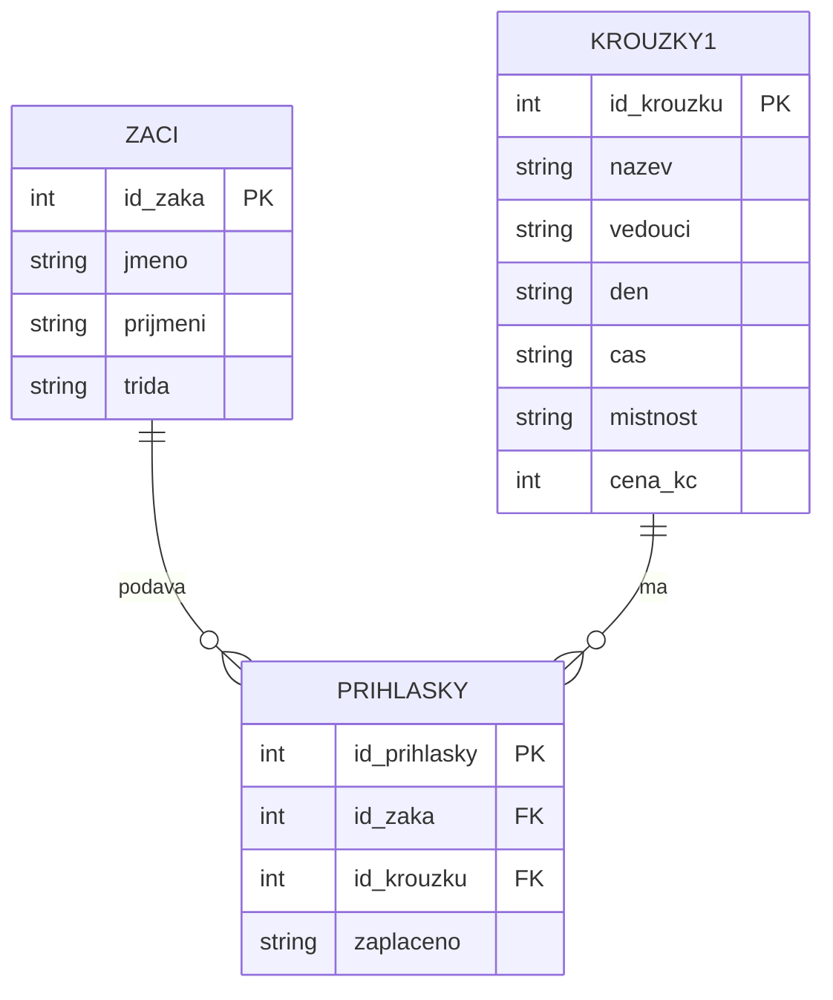

# SP1 Kroužky
muj kod: 5

1\. Zbytečné opakování údajů: Jména žáků, názvy kroužků, vedoucí, časy a ceny se opakují na více řádcích. Bylo by vhodnější oddělit údaje o žácích a kroužcích do samostatných tabulek, aby se stejné informace nemusely stále zapisovat.

2\. Nekonzistentní zápis údajů: Stejné údaje jsou zapsané různými způsoby, například „Robotika“, „robotika“ a „ROBOTIKA“ nebo „čt“ a „čtvrtek“. Také jméno vedoucího Horáka je uvedeno jako „Mgr. Horák“, „Horák“ a „Horak“, což může komplikovat filtrování a vyhodnocování dat.

3\. Nelze spolehlivě odpovědět na některé otázky: Z tabulky nelze jednoznačně zjistit, kolik různých kroužků škola nabízí, protože stejné kroužky mají různě zapsané názvy a tabulka neobsahuje úplný seznam kroužků. Navíc u některých žáků chybí údaj o zaplacení, takže nelze přesně určit, kdo ještě nezaplatil.

zaci.csv > primarní klíč: id_zaka
krouzky1.csv > primarní klíč: id_krouzku
prihlasky.csv > primarní klíč: id_prihlasky
cizí klíče: id_zaka, id_krouzku

### ER diagram



Tabulka `prihlasky.csv` propojuje žáky s kroužky. Jeden žák může mít více přihlášek a do jednoho kroužku se může přihlásit více žáků.


```sql
SELECT nazev, cena
FROM krouzky
WHERE cena > 500;
```