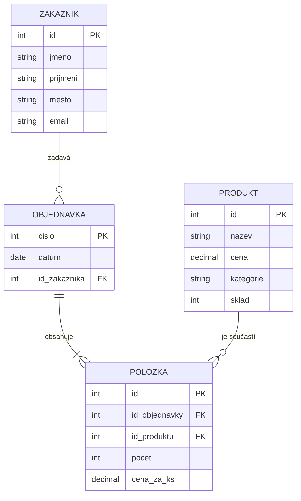

# Aplikační software — IT2, 2026/27

Repozitář pro předmět AS (databáze). Sem ukládám všechna cvičení
za celý školní rok. Odevzdává se commitem, ne mailem.

## Struktura

- `2026-09/` — září: Git, první data
- `2026-10/` — říjen: relační model
- (další měsíce přibudou)

## Kdo

Založeno 26. 9. 2026. 
Kód žáka: 5 · třída IT2

# Model e-shopu

